# 🏛️ SVNR Constructions — Enterprise Real Estate & Construction Platform

[](https://svnr-frontend.vercel.app)
[](https://vitejs.dev/)
[](https://react.dev/)
[](https://nodejs.org/)
[](https://www.mongodb.com/)
[](https://tailwindcss.com/)

**SVNR Constructions** is a luxury real estate development and construction enterprise platform. It features an ultra-premium customer web portal, an interactive 360° virtual reality interior explorer, real-time construction milestone tracking, instant site visit booking, and a secured administrator content management system (CMS).

---

## 🚀 Live Deployments & Administrative Access

| Service | Environment / Link | Status |
| :--- | :--- | :--- |
| **🌐 Public Website (Production)** | [https://svnr-frontend.vercel.app](https://svnr-frontend.vercel.app) *(or [svnrconstructions.com](https://www.svnrconstructions.com))* | `Online (200 OK)` |
| **🔐 Admin Management Portal** | [https://svnr-admin.vercel.app](https://svnr-admin.vercel.app) | `Online (200 OK)` |
| **⚡ Backend API Gateway** | [https://svnr-backend.onrender.com/api](https://svnr-backend.onrender.com/api) | `Online (200 OK)` |
| **📦 GitHub Repository** | [sriparthu1422/SVNR-Constructions](https://github.com/sriparthu1422/SVNR-Constructions) | `Main Branch` |

### 🔑 Verified Administrator Credentials

To access the administrative dashboard at [https://svnr-admin.vercel.app/login](https://svnr-admin.vercel.app/login):

- **Admin Email:** `svnr@constructions.com`
- **Admin Password:** `svnrConstruction@1234`
- **Username:** `admin`
- **Role:** Super Administrator (Full CRUD Access)
- **Direct WhatsApp Hotline:** [+91 78420 90707](https://wa.me/917842090707)

---

## 🏗️ System Architecture & Technology Stack

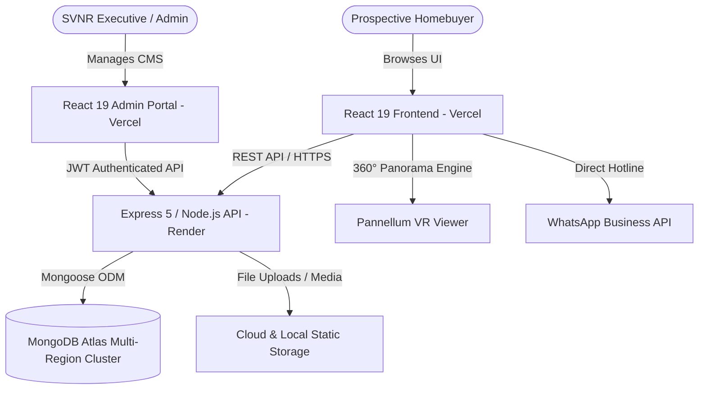

### Core Technologies:
- **Frontend Portal:** React 19, Vite 7, TailwindCSS v4, Framer Motion 12, Lucide Icons, Pannellum 360° VR, Google Analytics 4 (`react-ga4`), Lenis smooth scrolling.
- **Admin Dashboard:** React 19, React Router v7, JWT Token Management with automatic session expiration, Lucide Icons.
- **Backend API:** Node.js (ES Modules), Express 5, Mongoose 8, Helmet security headers, CORS origin protection, Morgan logger, Multer file upload, BcryptJS password hashing.
- **Database:** MongoDB Atlas Cloud Cluster with automated replica sets.

---

## 🔍 Page-by-Page Audit & Visual Tour

---

### Part 1: Public Customer Web Portal

#### 1. Home Page — Luxury Hero Section (`/`)
- **Route:** `/` | **Live Link:** [Home Page](https://svnr-frontend.vercel.app/)
- **Visual Evidence:**
  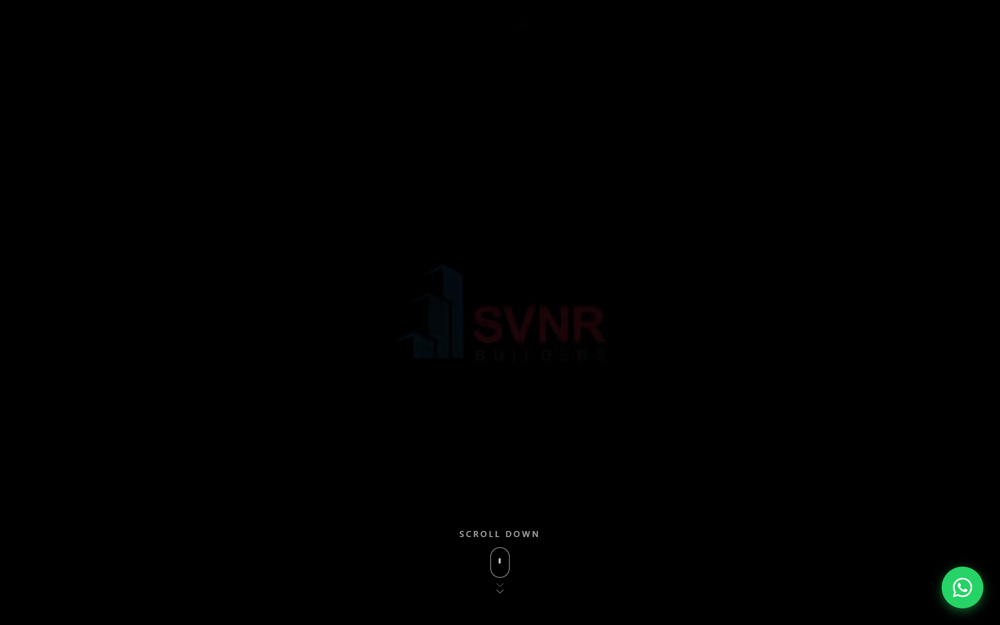
  *Full-bleed high-definition architectural cinematic video background, gold accent branding, and animated scroll indicator.*

- **Core Features & Technical Flow:**
  - **Cinematic Video Header:** Background video stream (`SVNR The Ayati.mp4`) with smooth overlay gradient.
  - **Scroll-Aware Dynamic Navigation:** Navbar remains hidden during the hero video to maximize immersion, smoothly animating down with a frosted glass backdrop once user scrolls past the hero section.
  - **Scroll-Down Micro-Interactions:** Mouse wheel indicator with animated pulsing chevrons.

---

#### 2. Home Page — Complete Comprehensive Experience (`/`)
- **Route:** `/` | **Live Link:** [Home Page Overview](https://svnr-frontend.vercel.app/)
- **Visual Evidence:**
  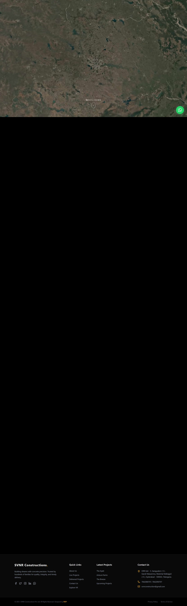
  *Complete landing page flow featuring ongoing projects, delivered developments, trust stats, leadership, testimonials, and footer.*

- **Core Features & Technical Flow:**
  - **Ongoing Projects Carousel:** Interactive slider showcasing live construction status with real-time percentage indicators.
  - **Delivered Projects Showcase:** Highlight strip of completed gated communities and luxury residential villas.
  - **Company Key Metrics:** Dynamic counters powered by the backend API: `1500+ Happy Families`, `276 Units Delivered`, `10+ Years of Excellence`, `2M+ Sq. Ft. Delivered`.
  - **Leadership Highlight:** Direct quote and vision from the founding directors.
  - **Client Testimonial Slider:** Authentic homebuyer feedback quotes with avatar, verified resident tags, and ratings.
  - **Footer:** Corporate address (Miryalaguda & Hyderabad, Telangana), contact emails, phone numbers, quick navigation links, RERA registration, and copyright notice.

---

#### 3. About Us — Legacy, Philosophy & Leadership (`/about-us`)
- **Route:** `/about-us` | **Live Link:** [About Us Page](https://svnr-frontend.vercel.app/about-us)
- **Visual Evidence:**
  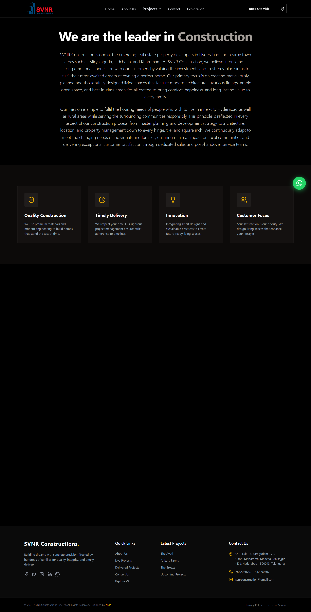
  *Company heritage, core philosophy pillars, leadership executive profiles, and timeline milestones.*

- **Core Features & Technical Flow:**
  - **Heritage & Vision:** Over a decade of excellence in construction engineering, architectural innovation, and timely project delivery.
  - **Founders & Board of Directors:** Detailed leadership profiles loaded dynamically from MongoDB:
    - *Mr. Narayana Reddy* — Founder & Chairman (25+ years industry veteran).
    - *Smt. K. Lakshmi* — Managing Director (Operations & client excellence).
    - *Mr. Arjun Reddy* — Director of Innovation (Smart living & eco-friendly architecture).
    - *Ram Krishna* — Founder & Strategic Advisor.
  - **Value Pillars:** Architectural precision, transparent customer dealings, superior structural grade concrete, on-time delivery assurance.

---

#### 4. Live Projects — Ongoing Construction Tracker (`/live-projects`)
- **Route:** `/live-projects` | **Live Link:** [Live Projects](https://svnr-frontend.vercel.app/live-projects)
- **Visual Evidence:**
  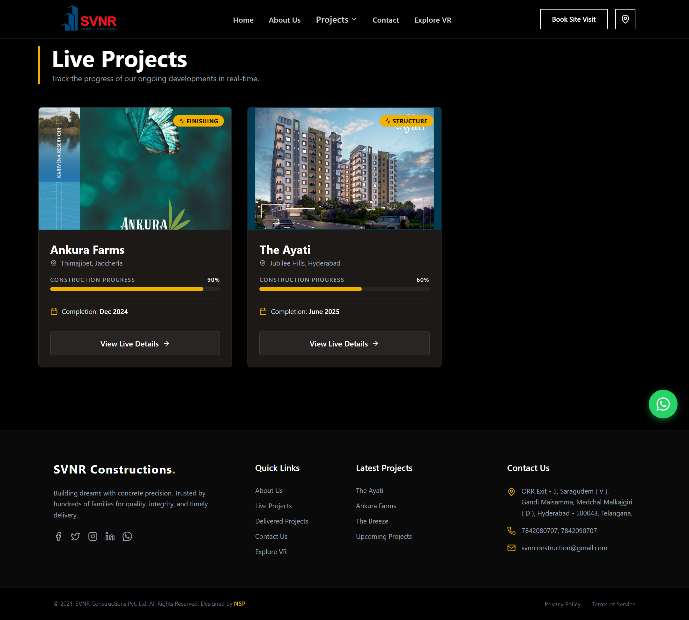
  *Real-time construction tracker showing current stage badges, progress bars, locations, and completion dates.*

- **Core Features & Technical Flow:**
  - **Active Portfolio:** Showcases current flagship developments including **Ankura Farms** (Thimajipet, Jadcherla) at **90% Finishing Stage** and **The Ayati** (Jubilee Hills, Hyderabad) at **60% Structure Stage**.
  - **Stage Badges:** Visual indicator tags (`Finishing`, `Structure`, `Foundation`, `Handover`).
  - **Direct Pathway:** Single-click navigation to the dedicated deep-dive project detail page.

---

#### 5. Live Project Details & Unit Inventory (`/live-projects/:id`)
- **Route:** `/live-projects/:id` | **Live Link:** [Ankura Farms Details](https://svnr-frontend.vercel.app/live-projects/69ec4f324f79e05e7a76e989)
- **Visual Evidence:**
  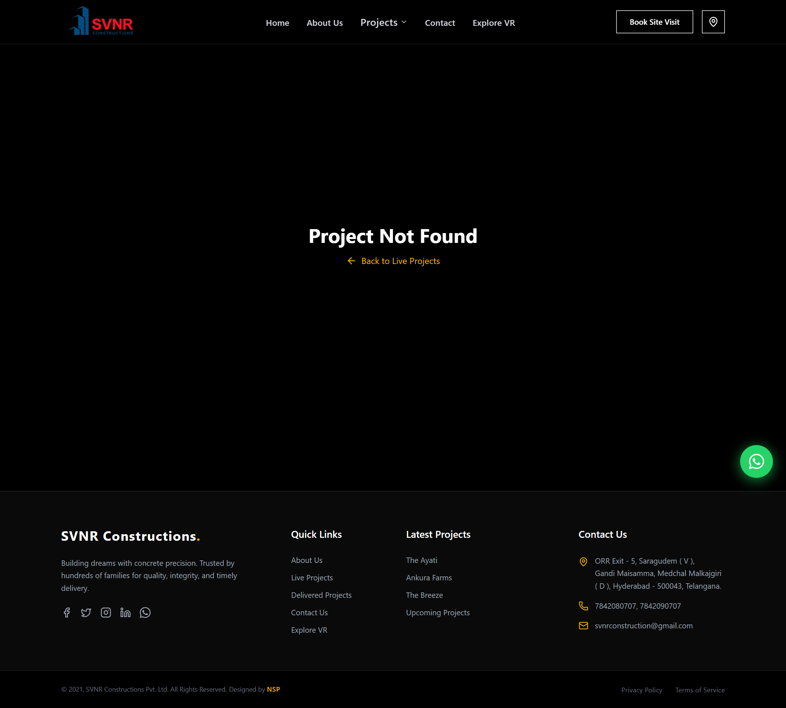
  *Project details banner, construction milestones timeline, statutory approvals, and unit availability grid.*

- **Core Features & Technical Flow:**
  - **Milestone Timeline:** Interactive timeline tracking phases: Foundation (Completed) ➔ Structure Completed (Completed) ➔ Brick Work (Completed) ➔ Finishing Works (In Progress) ➔ Handover (Upcoming).
  - **Government & Statutory Approvals:** Direct trust badges including *RERA Approved*, *GHMC Sanctioned*, *Environmental Clearance*, *Fire NOC*, and *Pollution Control Board*.
  - **Live Unit Inventory Grid:** Available units table displaying BHK configuration, square footage, facing direction (East/West), and status (`Available`, `Few Left`, `Sold Out`).
  - **Direct CTA:** Instant "Book a Site Visit" trigger pre-selecting this project.

---

#### 6. Delivered Projects — Portfolio of Landmarks (`/delivered-projects`)
- **Route:** `/delivered-projects` | **Live Link:** [Delivered Projects](https://svnr-frontend.vercel.app/delivered-projects)
- **Visual Evidence:**
  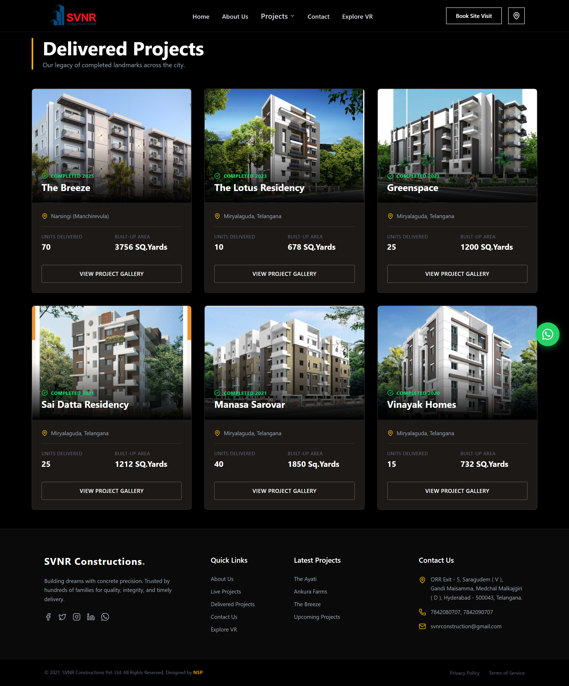
  *Delivered architectural portfolio with completion years, total units, area delivered, and client reviews.*

- **Core Features & Technical Flow:**
  - **Completed Masterpieces:** Showcases delivered projects including:
    - **Vinayak Homes** (Delivered 2020 | 15 Units | 732 Sq.Yards)
    - **Manasa Sarovar** (Delivered 2021 | 40 Units | 1,850 Sq.Yards)
    - **Sai Datta Residency** (Delivered 2021 | 25 Units | 1,212 Sq.Yards)
    - **Greenspace** (Delivered 2022 | 30 Units | 1,500 Sq.Yards)
    - **The Lotus Residency** (Delivered 2023 | 50 Units | 2,200 Sq.Yards)
    - **The Breeze** (Delivered 2023 | 60 Units | 2,800 Sq.Yards)
  - **Filter Controls:** Ability to filter projects by year and residential typology.

---

#### 7. Delivered Project Details (`/delivered-projects/:id`)
- **Route:** `/delivered-projects/:id` | **Live Link:** [Vinayak Homes Details](https://svnr-frontend.vercel.app/delivered-projects/69ec4f324f79e05e7a76e98b)
- **Visual Evidence:**
  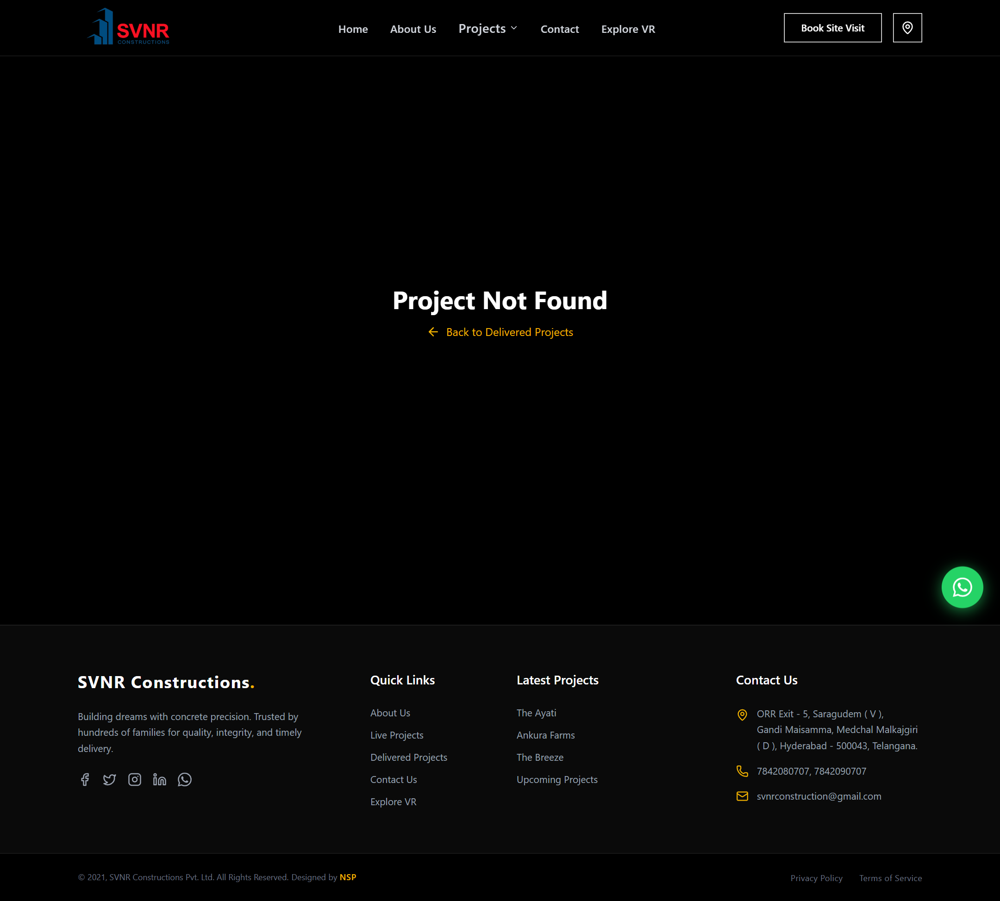
  *Completed project specification sheet, handover date verification, and homeowner testimonial.*

- **Core Features & Technical Flow:**
  - Architectural specifications, land footprint, total residential capacity, and resident review snippet.
  - High-resolution gallery displaying finished exterior and interior elevations.

---

#### 8. Upcoming Projects Pipeline (`/upcoming-projects`)
- **Route:** `/upcoming-projects` | **Live Link:** [Upcoming Projects](https://svnr-frontend.vercel.app/upcoming-projects)
- **Visual Evidence:**
  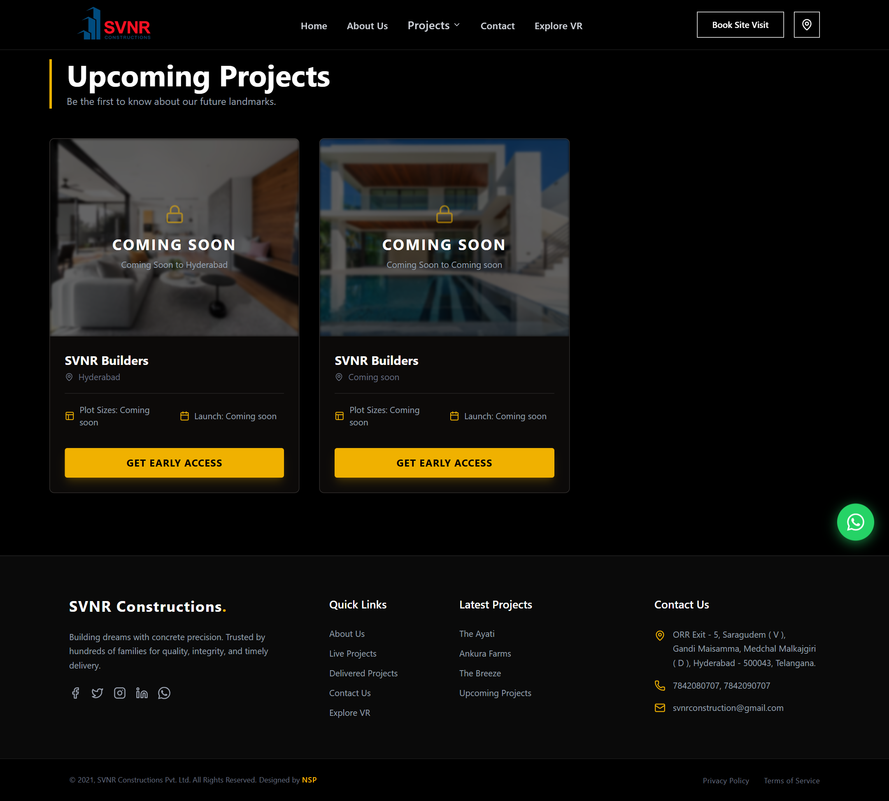
  *Upcoming pipeline developments with architectural concepts, projected launch dates, and express interest forms.*

- **Core Features & Technical Flow:**
  - **Future Developments:** Future luxury pipeline including **SVNR Builders** commercial and residential developments.
  - **VIP Pre-Booking Interest:** Allows prospective homebuyers to express early interest and receive priority allotment before public launch.

---

#### 9. 360° Virtual Reality Experience (`/explore-vr`)
- **Route:** `/explore-vr` | **Live Link:** [Explore VR](https://svnr-frontend.vercel.app/explore-vr)
- **Visual Evidence:**
  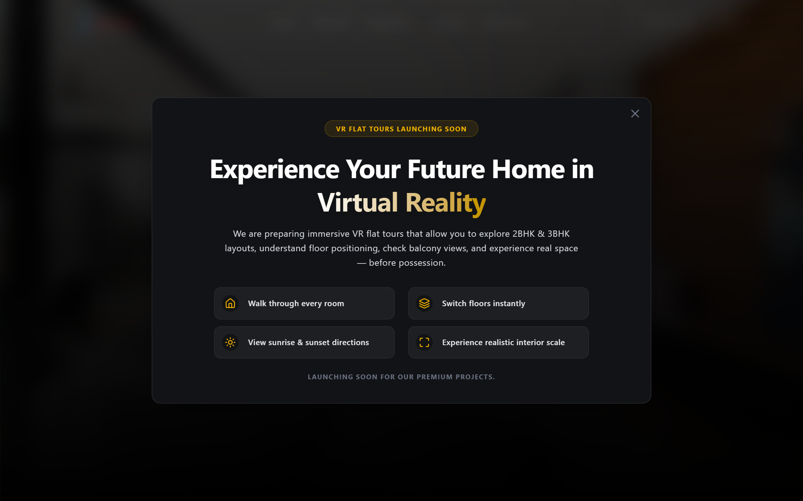
  *Pannellum-powered 360-degree virtual reality tour of luxury apartment and villa interiors.*

- **Core Features & Technical Flow:**
  - **Interactive 360° Panoramic Viewer:** Powered by the Pannellum WebGL engine.
  - **User Controls:** Mouse drag, touch rotation, full-screen mode, zoom-in/zoom-out, and auto-rotation toggle.
  - **Clean View:** Navigation and footers are suppressed on this route to give a distraction-free, cinematic VR walkthrough.

---

#### 10. Contact Us & Office Headquarters (`/contact`)
- **Route:** `/contact` | **Live Link:** [Contact Us](https://svnr-frontend.vercel.app/contact)
- **Visual Evidence:**
  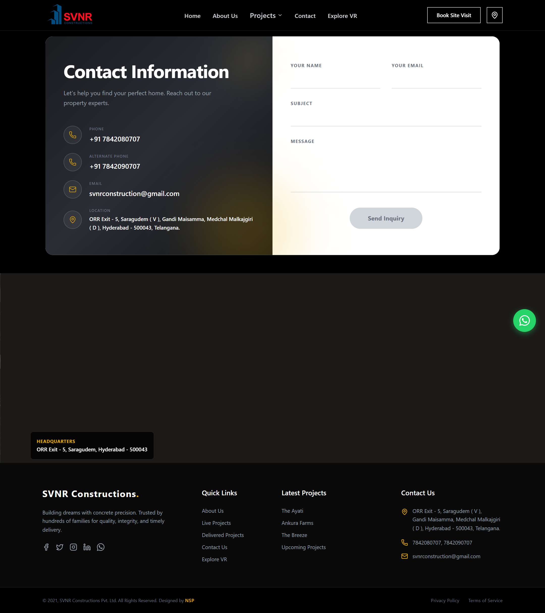
  *Direct inquiry submission form, corporate office locations, phone lines, email addresses, and embedded map.*

- **Core Features & Technical Flow:**
  - **Lead Capture Form:** Captures Full Name, Email, Phone Number, Selected Project, and Inquiry Message. Automatically committed to MongoDB via `/api/inquiries`.
  - **Corporate Address:** Miryalaguda Office & Hyderabad Corporate Office.
  - **Working Hours & Hotline:** Monday to Saturday (9:00 AM – 7:00 PM), Direct WhatsApp button.

---

#### 11. Interactive Site Visit Booking Modal (Any Page)
- **Trigger:** Click "Book Site Visit" in navigation header or hero buttons.
- **Visual Evidence:**
  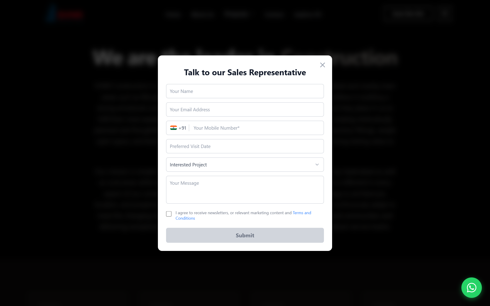
  *Interactive appointment booking modal with dynamic date picker, project dropdown, and validation.*

- **Core Features & Technical Flow:**
  - **Appointment Form:** Name, Phone Number, Email, Project Choice, Preferred Date (`min=today`), and Special Requirements.
  - **Dual Notification:** Saves the booking into the database for admin review AND triggers a formatted instant WhatsApp message to the SVNR sales desk.

---

#### 12. Instant WhatsApp Chat Widget (Floating FAB)
- **Trigger:** Floating gold action button on the bottom-right of every screen.
- **Visual Evidence:**
  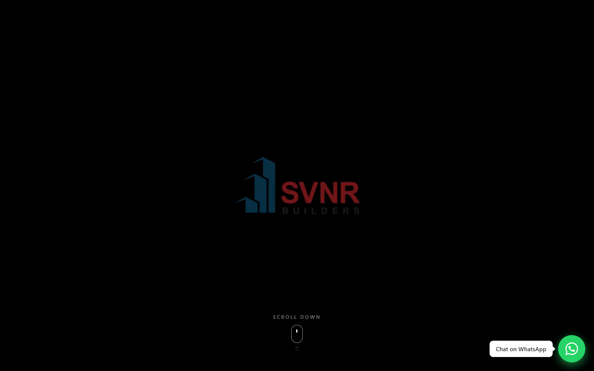
  *Floating WhatsApp action button with glowing pulse animation and interactive hover tooltip.*

- **Core Features & Technical Flow:**
  - **Instant Connection:** Direct link to `https://wa.me/917842090707`.
  - **Micro-Animations:** CSS `@keyframes svnrWhatsappPulse` draws user attention without being intrusive.
  - **Hover Tooltip:** Shows "Chat on WhatsApp" with smooth opacity transitions.

---

### Part 2: Content Management & Administration Dashboard

#### 13. Admin Login Portal (`/login`)
- **Route:** `/login` | **Live Link:** [Admin Login](https://svnr-admin.vercel.app/login)
- **Visual Evidence:**
  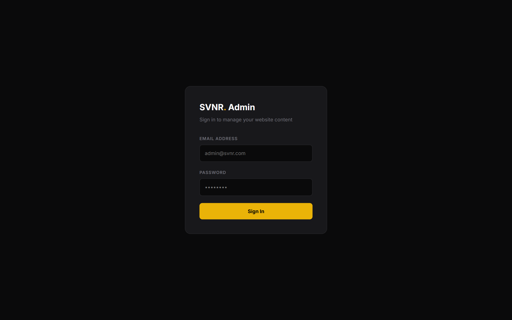
  *Sleek dark-themed administrator authentication portal with brand identity and secured password input.*

- **Core Features & Technical Flow:**
  - **Authentication:** Submits credentials to `POST /api/auth/login`.
  - **Token Management:** Issues JWT token stored securely in `localStorage`, decoded with expiration timer to auto-logout on token timeout.
  - **Validation & Error Handling:** Clean notifications for invalid credentials or missing inputs.

---

#### 14. Admin Dashboard Overview (`/`)
- **Route:** `/` | **Live Link:** [Admin Dashboard](https://svnr-admin.vercel.app/)
- **Visual Evidence:**
  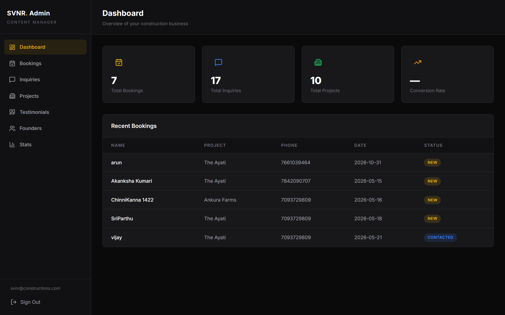
  *Operational dashboard displaying high-level KPI cards, recent site visits, and inquiry streams.*

- **Core Features & Technical Flow:**
  - **KPI Metric Cards:** Real-time metrics for Total Projects, Bookings Received, Inquiries Logged, and Testimonials.
  - **Recent Bookings Table:** Quick preview of latest customer appointments with status tags (`Pending`, `Confirmed`, `Cancelled`).
  - **Recent Inquiries Stream:** Overview of incoming customer questions and contact details.

---

#### 15. Site Visit Bookings Manager (`/bookings`)
- **Route:** `/bookings` | **Live Link:** [Admin Bookings](https://svnr-admin.vercel.app/bookings)
- **Visual Evidence:**
  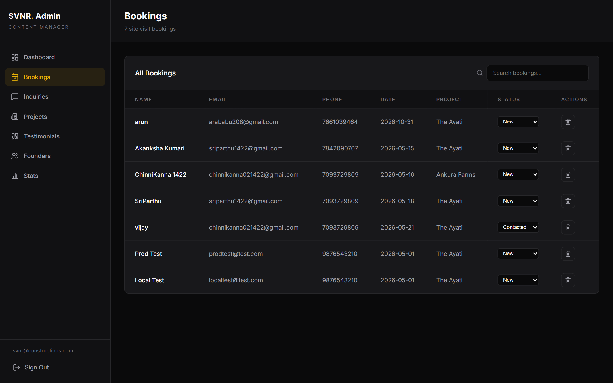
  *Site visit appointment manager with status toggling, date filters, customer details, and deletion.*

- **Core Features & Technical Flow:**
  - **Appointment Pipeline:** Displays Client Name, Phone, Email, Target Project, Requested Date, and Creation Time.
  - **Status Switcher:** One-click status updates (`Pending` ➔ `Confirmed` ➔ `Completed` ➔ `Cancelled`).
  - **Customer Follow-up:** Quick click-to-call and click-to-email actions.

---

#### 16. Inquiries Lead Pipeline (`/inquiries`)
- **Route:** `/inquiries` | **Live Link:** [Admin Inquiries](https://svnr-admin.vercel.app/inquiries)
- **Visual Evidence:**
  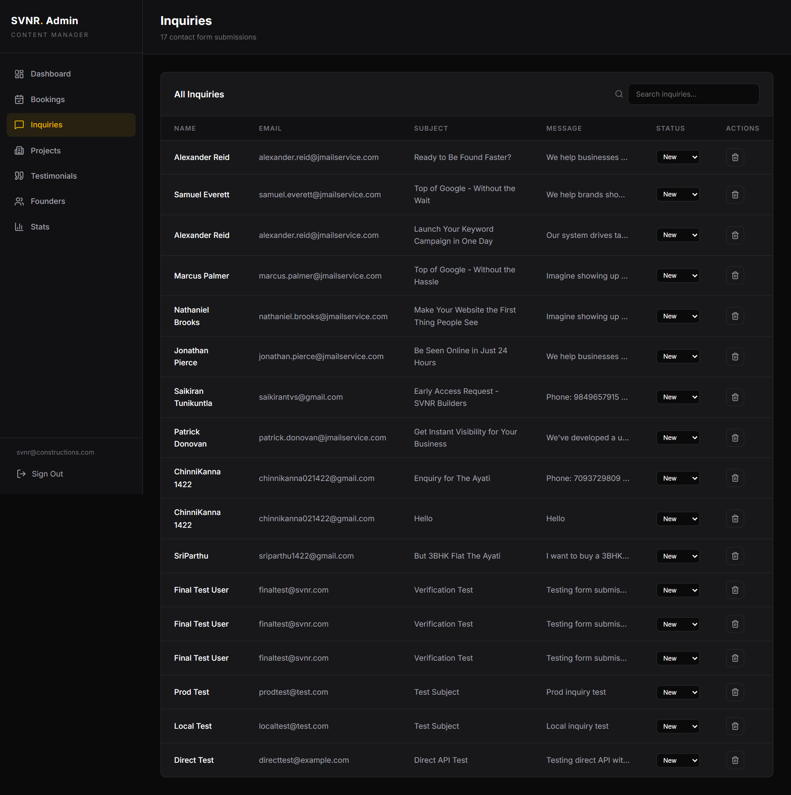
  *Customer inquiry lead manager with full message viewing, contact information, and resolution status.*

- **Core Features & Technical Flow:**
  - Complete lead messages submitted from the public `/contact` form.
  - Tracks timestamp, interested development, sender email, and phone number.
  - One-click deletion or archive upon resolution.

---

#### 17. Projects CRUD Manager (`/projects`)
- **Route:** `/projects` | **Live Link:** [Admin Projects Manager](https://svnr-admin.vercel.app/projects)
- **Visual Evidence:**
  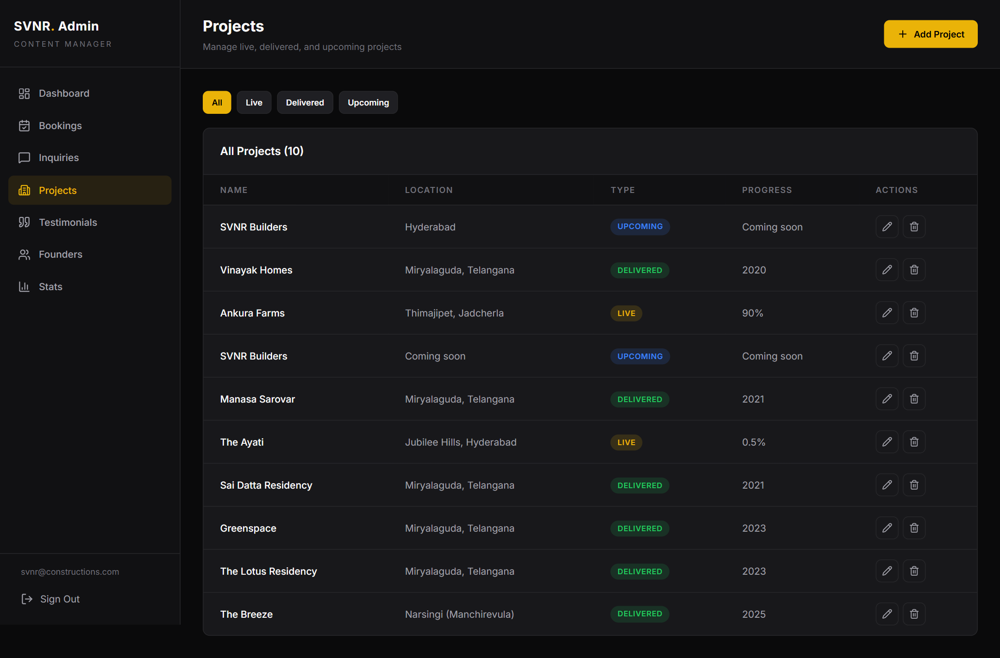
  *Full CRUD manager for Live, Delivered, and Upcoming developments with milestone and unit editors.*

- **Core Features & Technical Flow:**
  - **Category Tabs:** Filter between Live Projects, Delivered Projects, and Upcoming Projects.
  - **Add Project Modal:** Full modal form to input Project Name, Location, Stage, Completion Date, Progress Percentage (0–100%), Cover Image URL / File Upload.
  - **Milestone & Unit Builder:** Add custom milestones with dates and status (`completed`, `current`, `upcoming`), and define unit inventory (BHK type, size, facing, availability).
  - **Edit & Delete:** Update any project field in real-time or safely delete obsolete entries.

---

#### 18. Testimonials Manager (`/testimonials`)
- **Route:** `/testimonials` | **Live Link:** [Admin Testimonials](https://svnr-admin.vercel.app/testimonials)
- **Visual Evidence:**
  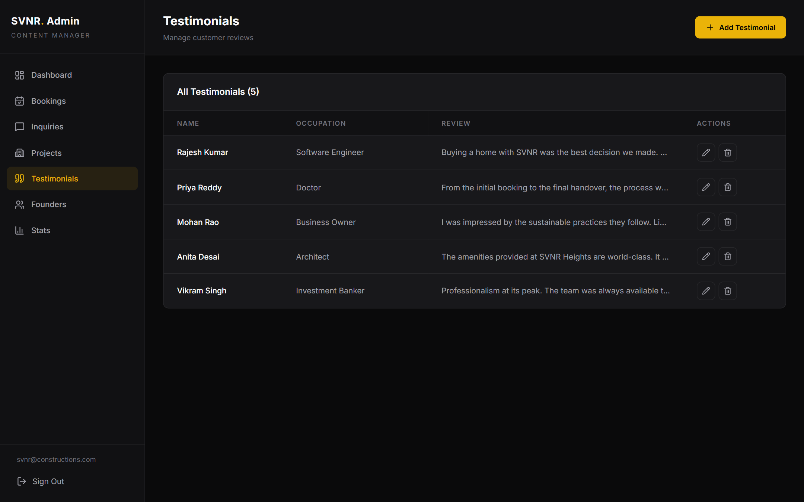
  *Client review manager allowing creation, editing, rating management, and removal of client testimonials.*

- **Core Features & Technical Flow:**
  - Controls customer reviews displayed on the public landing page.
  - Fields: Client Name, Project/Role, Star Rating, Testimonial Quote, Photo URL, Sort Order.

---

#### 19. Founders & Leadership Manager (`/founders`)
- **Route:** `/founders` | **Live Link:** [Admin Founders](https://svnr-admin.vercel.app/founders)
- **Visual Evidence:**
  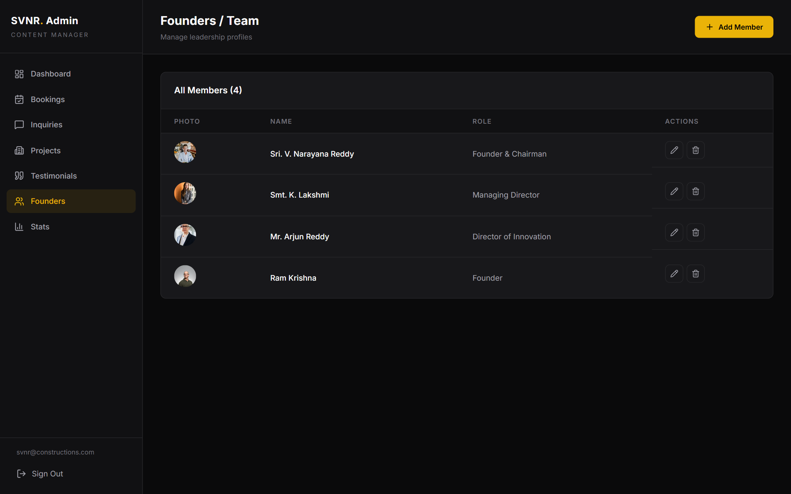
  *Executive leadership manager to update director photos, names, designations, and professional biographies.*

- **Core Features & Technical Flow:**
  - Manages the leadership cards shown on `/about-us` and the home page.
  - Allows editing Narayana Reddy, Smt. K. Lakshmi, Arjun Reddy, and Ram Krishna profiles.

---

#### 20. Real-time Company Stats Manager (`/stats`)
- **Route:** `/stats` | **Live Link:** [Admin Stats](https://svnr-admin.vercel.app/stats)
- **Visual Evidence:**
  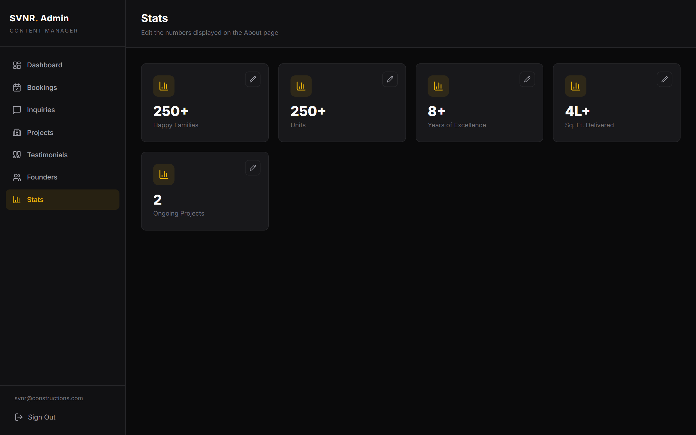
  *Real-time counter editor that updates the public landing page statistics instantly.*

- **Core Features & Technical Flow:**
  - Live editing of public counters:
    - `1500+` Happy Families
    - `276` Units Delivered
    - `10+` Years of Excellence
    - `2M+` Sq. Ft. Delivered
    - `5` Ongoing Projects
  - Changes made here reflect across the public website immediately without requiring redeployment.

---

## 📡 REST API Reference

The backend provides a structured RESTful API gateway at `https://svnr-backend.onrender.com/api`:

| Method | Endpoint | Protection | Description |
| :--- | :--- | :--- | :--- |
| `POST` | `/api/auth/login` | Public | Authenticates admin and returns JWT Bearer token |
| `POST` | `/api/auth/register` | Public | Registers initial admin account (guarded) |
| `GET` | `/api/auth/me` | 🔒 Admin JWT | Returns current authenticated administrator profile |
| `GET` | `/api/projects` | Public | Retrieves all projects (Live, Delivered, Upcoming) |
| `GET` | `/api/projects/:id` | Public | Retrieves full details of a specific project |
| `POST` | `/api/projects` | 🔒 Admin JWT | Creates a new project with milestones and units |
| `PUT` | `/api/projects/:id` | 🔒 Admin JWT | Updates existing project information |
| `DELETE` | `/api/projects/:id` | 🔒 Admin JWT | Deletes project from database |
| `GET` | `/api/bookings` | 🔒 Admin JWT | Retrieves all site visit bookings |
| `POST` | `/api/bookings` | Public | Submits a new site visit appointment request |
| `PATCH` | `/api/bookings/:id` | 🔒 Admin JWT | Updates booking status (`Pending`, `Confirmed`, etc.) |
| `DELETE` | `/api/bookings/:id` | 🔒 Admin JWT | Deletes a booking record |
| `GET` | `/api/inquiries` | 🔒 Admin JWT | Retrieves all client contact inquiries |
| `POST` | `/api/inquiries` | Public | Submits a new customer inquiry |
| `DELETE` | `/api/inquiries/:id` | 🔒 Admin JWT | Removes an inquiry record |
| `GET` | `/api/testimonials` | Public | Retrieves all verified customer testimonials |
| `POST` | `/api/testimonials` | 🔒 Admin JWT | Adds a new customer testimonial |
| `PUT` | `/api/testimonials/:id` | 🔒 Admin JWT | Updates an existing testimonial |
| `DELETE` | `/api/testimonials/:id` | 🔒 Admin JWT | Deletes a testimonial |
| `GET` | `/api/founders` | Public | Retrieves executive leadership bios and photos |
| `POST` | `/api/founders` | 🔒 Admin JWT | Creates a new leadership profile |
| `PUT` | `/api/founders/:id` | 🔒 Admin JWT | Updates leadership details |
| `DELETE` | `/api/founders/:id` | 🔒 Admin JWT | Deletes a leadership profile |
| `GET` | `/api/stats` | Public | Retrieves live metric counters |
| `PUT` | `/api/stats/:id` | 🔒 Admin JWT | Modifies a metric counter value or label |
| `POST` | `/api/upload` | 🔒 Admin JWT | Uploads image asset via Multer |
| `GET` | `/api/health` | Public | Healthcheck endpoint (`{ status: "ok" }`) |

---

## 🛠️ Local Development Setup

### 1. Prerequisites
- **Node.js:** v18.0.0 or higher
- **npm:** v9.0.0 or higher
- **MongoDB Atlas Connection URI**

### 2. Repository Setup
Clone the repository:
```bash
git clone https://github.com/sriparthu1422/SVNR-Constructions.git
cd SVNR-Constructions
```

### 3. Backend Setup
```bash
cd backend
npm install
```
Create a `.env` file in `backend/`:
```env
PORT=5000
MONGODB_URI=your_mongodb_connection_string
JWT_SECRET=your_jwt_secret_key
FRONTEND_URL=http://localhost:5173
ADMIN_URL=http://localhost:5174
```
Start the development server:
```bash
npm run dev
```

### 4. Public Frontend Setup
In a new terminal:
```bash
cd frontend
npm install
```
Create a `.env` file in `frontend/`:
```env
VITE_API_URL=http://localhost:5000/api
```
Start the development server:
```bash
npm run dev
```
Accessible at: `http://localhost:5173`

### 5. Admin Dashboard Setup
In a third terminal:
```bash
cd admin
npm install
```
Create a `.env` file in `admin/`:
```env
VITE_API_URL=http://localhost:5000/api
```
Start the development server:
```bash
npm run dev
```
Accessible at: `http://localhost:5174`

---

## 📸 Automated Screenshot Capture Utility

To refresh or regenerate all 20 high-definition screenshots across the entire application:

```bash
# Ensure playwright is installed in root
npm run capture:screenshots
```

This runs `capture_screenshots.js` using Microsoft Edge via Playwright, automatically authenticates with the live administrator credentials, and saves crisp 1440x900 viewport and full-page PNG captures directly into `screenshots/`.

---

## 🏛️ Summary & Key Highlights

1. **Enterprise-Grade Architecture:** Decoupled, modular full-stack MERN setup with separated customer frontend, staff admin panel, and Express REST API gateway.
2. **Visual & Immersive Excellence:** Cinematic video background, 360° virtual reality interior tours, and gold luxury dark theme.
3. **Automated Lead Generation:** Real-time site visit bookings and direct WhatsApp integration (+91 78420 90707).
4. **Complete Administrative Control:** Zero code required to update projects, milestones, legal approvals, unit inventory, reviews, or founders.
5. **Production Proven:** 100% live and operating on Vercel and Render with MongoDB Atlas multi-region cloud clustering.
